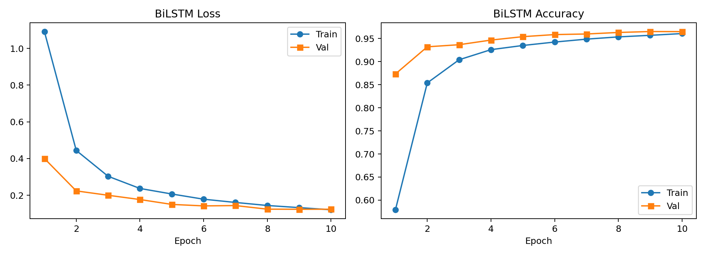

# Social Media Content Classification (Multiclass NLP)

A clean, modular, reproducible multiclass NLP pipeline for classifying social media posts across six emotional and mental-health categories (**Positive**, **Neutral**, **Anger**, **Depression**, **Sadness**, and **Anxiety**). Built as a university lab experiment with full exploratory analysis, social-media-aware preprocessing, classical TF-IDF baselines (with word+char ablation and `GridSearchCV`), a PyTorch **BiLSTM** deep learning model, error analysis, and a live CLI predictor.

---

## 1. Dataset Details

* **Source:** [Multiclass Social Media Dataset for Mental Health and Emotion Classification (Mendeley Data, v2)](https://data.mendeley.com/datasets/rw57wvg6z2/2) — DOI: `10.17632/rw57wvg6z2.2`
* **Raw File:** `data/raw/Mental_Health_6Class_Final_Cleaned.csv` (`42,518` rows, columns: `Unnamed: 0`, `Text`, `Emotion`)
* **After Auditing & Cleaning:** `42,505` unique posts (`0` nulls, `0` exact duplicates, **`11`** case/whitespace-normalized duplicates removed to prevent split leakage, **`2`** rows removed after becoming empty post-cleaning).
* **Language:** Predominantly English, with occasional informal Indonesian/Malay and K-pop slang in `Neutral` (e.g., `Wkwkwkwkwk`, `Alhamdulillah`, `Maknae`).

### Class Distribution & Imbalance

The dataset exhibits **moderate class imbalance (2.06× ratio between `Positive` and `Anxiety`)** and a strong **text-length skew** on `Depression` (median 122 words vs. 10–23 words for the other five classes):

| Class (`Emotion`) | Count (Post-Dedup) | Share | Mean Words | Median Words | Train (70%) | Val (15%) | Test (15%) |
| :--- | ---: | ---: | ---: | ---: | ---: | ---: | ---: |
| `Positive` | 9,766 | 22.98% | 23.16 | 21.0 | 6,836 | 1,465 | 1,465 |
| `Neutral` | 7,899 | 18.58% | 17.68 | 10.0 | 5,529 | 1,184 | 1,184 |
| `Anger` | 7,121 | 16.75% | 21.40 | 19.0 | 4,985 | 1,068 | 1,068 |
| `Depression` | 6,762 | 15.91% | 176.41 | 122.0 | 4,733 | 1,014 | 1,015 |
| `Sadness` | 6,221 | 14.64% | 20.37 | 18.0 | 4,355 | 933 | 933 |
| `Anxiety` | 4,738 | 11.15% | 24.27 | 23.0 | 3,315 | 712 | 711 |
| **Total** | **42,507** *(42,505 split)* | **100%** | **45.94** | **21.0** | **29,753** | **6,376** | **6,376** |

> **Why Macro-F1 & Class Weights:** Because `Positive` is 2.06× larger than `Anxiety`, we apply **balanced class weights** (`class_weight="balanced"` in sklearn and inverse-frequency weights in PyTorch `CrossEntropyLoss`) computed **only on the training split** after splitting (never oversampling before the split, avoiding data leakage) and use **Macro-F1** as the primary evaluation metric.


---

## 2. Project Structure

```text
socialmediaexp/
├── data/
│   ├── raw/                     # Place Mental_Health_6Class_Final_Cleaned.csv here
│   └── processed/               # Stratified train.csv, val.csv, test.csv
├── notebooks/
│   ├── 01_eda.ipynb             # Dataset audit, EDA plots, preprocessing examples
│   └── 02_experiments.ipynb     # Ablation, GridSearchCV, BiLSTM curves, error analysis
├── src/
│   ├── __init__.py
│   ├── utils.py                 # Global seed (42), device detection, logging, paths
│   ├── data_loader.py           # Loading, null/duplicate audit, EDA summary & 4 plots
│   ├── preprocess.py            # Social-media cleaning, contraction expansion, 70/15/15 split
│   ├── features.py              # Word+Char TF-IDF, Word-Only TF-IDF, BiLSTM sequence vocab
│   ├── train_classical.py       # NB, LogReg, LinearSVM, Word-Only ablation, GridSearchCV
│   ├── train_deep.py            # GPU check -> PyTorch BiLSTM with early stopping
│   └── evaluate.py              # Test metrics, raw+norm confusion matrices, error analysis, predict_post
├── models/                      # Saved vectorizers, label encoder, classical & BiLSTM weights
├── results/                     # Metrics CSV/JSON, classification reports, plots
├── main.py                      # End-to-end pipeline runner & CLI (--predict)
├── requirements.txt             # Pinned Python dependencies
├── .gitignore                   # Excludes raw/processed CSVs, model binaries, venvs
└── README.md
```

---

## 3. Pipeline Walkthrough

### Step 1: Data Collection & EDA (`src/data_loader.py`)
* Loads `Mental_Health_6Class_Final_Cleaned.csv`, drops `Unnamed: 0`, checks nulls (`0`), empty strings (`0`), exact duplicates (`0`), and case/whitespace-normalized duplicates (`11` removed).
* Audits social-media noise: the raw Mendeley CSV was pre-cleaned by its authors (`0` `@mentions`, `0` `#hashtags`, `0` Unicode emojis, `0` apostrophes), while retaining `7` URLs (including broken `httpwww.*` links), `1,952` posts with elongated characters (`>=3` repeats), `1,861` with repeated punctuation, and `8,067` with apostrophe-less contractions (`im`, `dont`, `cant`, `wasnt`).
* Saves 4 plots (`eda_class_distribution.png`, `eda_length_distribution.png`, `eda_top_words_per_class.png`, `eda_social_artifacts_per_class.png`) and `results/eda_summary.json`.

### Step 2: Social-Media Text Preprocessing (`src/preprocess.py`)
* **URLs & Mentions:** Maps standard and malformed URLs (`https://...`, `www.*`, `httpwww.*`) to `<URL>` and `@mentions` to `<USER>`.
* **Hashtags & Emojis:** Drops `#` and splits CamelCase hashtags (`#FoodLover` → `food lover`); converts Unicode emojis to descriptive words via `emoji.demojize()` (`😢` → `cry face`) for live/raw posts.
* **Normalization:** Collapses elongated characters (`sooooo` → `soo`) and repeated punctuation (`!!` → `!`), cleans HTML remnants (`amp`, `quot`), and expands both standard (`don't` → `do not`) and apostrophe-less (`dont` → `do not`, `im` → `i am`) contractions.
* **Stopwords & Lemmatization:** Filters English NLTK stopwords **while preserving negations** (`not`, `no`, `nor`, `never`, `neither`, `cannot`, etc.), then lemmatizes with `WordNetLemmatizer`.
* **Stratified Split:** `70%` train (`29,753`) / `15%` validation (`6,376`) / `15%` test (`6,376`) with `random_state=42`.

### Step 3: Feature Extraction (`src/features.py`)
* **Classical (Combined):** `FeatureUnion` of **Word TF-IDF (1–2 n-grams, 50,000 features)** + **Character-wb TF-IDF (2–5 n-grams, 50,235 features)** = **100,235 sparse features**.
* **Classical Ablation:** Word-only TF-IDF (1–2 n-grams, 50,000 features) to quantify the impact of character n-grams.
* **Deep Learning:** Vocabulary (`13,904` tokens, `min_freq=2`) built strictly from `train.csv` with padded integer sequences (`max_len=128`).

### Step 4: Model Training (`src/train_classical.py`, `src/train_deep.py`)
* **Classical Baselines:** `MultinomialNB(alpha=0.5)`, `LogisticRegression(class_weight="balanced")`, and `LinearSVC(class_weight="balanced")`.
* **Hyperparameter Tuning:** `GridSearchCV(cv=3, scoring="f1_macro")` on the winning baseline (`LinearSVM`, `C ∈ {0.25, 0.5, 1.0, 2.0}` → best `C=1.0`, CV Macro-F1 = `0.9595`).
* **Deep Learning (Hardware-Aware):** Checks `torch.cuda.is_available()`; on this CPU-only machine, defaults to a **PyTorch BiLSTM** (`Embedding(64)` → `BiLSTM(64)` → masked mean+max pooling → MLP classifier) trained with class-weighted `CrossEntropyLoss`, `AdamW`, gradient clipping, and early stopping on validation Macro-F1 (best checkpoint at **Epoch 9**, val Macro-F1 = `0.9669`).

### Step 5: Evaluation & Error Analysis (`src/evaluate.py`)
* Evaluates all 6 trained variants on the held-out test set (`6,376` posts).
* Generates raw-count and normalized confusion matrices (`results/cm_*.png`), `results/model_comparison.csv`, `results/classification_reports.txt`, and `results/error_analysis.csv` (`233/6,376` errors = `3.65%` error rate for the winning model).

---

## 4. Installation & Usage

### Setup
```bash
git clone https://github.com/mansi27102005/clnlp_exp9.git
cd clnlp_exp9

python -m venv .venv
# Windows:
.venv\Scripts\activate
# Linux/macOS:
# source .venv/bin/activate

pip install -r requirements.txt
```

Download `Mental_Health_6Class_Final_Cleaned.csv` from [Mendeley Data](https://data.mendeley.com/datasets/rw57wvg6z2/2) and place it in `data/raw/Mental_Health_6Class_Final_Cleaned.csv`.

### Run Full Pipeline
```bash
python main.py
```

### Predict on a Raw Social Media Post
```bash
python main.py --predict "I feel so nervous and terrified about my exam tomorrow!" --model LogisticRegression
```

### Run Notebooks
```bash
jupyter notebook notebooks/01_eda.ipynb
jupyter notebook notebooks/02_experiments.ipynb
```

---

## 5. Results (Held-Out Test Set, `N = 6,376`)

| Model | Accuracy | Macro Precision | Macro Recall | **Macro F1** | Weighted F1 |
| :--- | ---: | ---: | ---: | ---: | ---: |
| **LinearSVM_Tuned** (`C=1.0`, Word+Char TF-IDF) | **0.9635** | **0.9652** | **0.9648** | **0.9649** | **0.9632** |
| **LinearSVM** (Word+Char TF-IDF) | 0.9635 | 0.9652 | 0.9648 | 0.9649 | 0.9632 |
| **BiLSTM** (PyTorch, CPU) | 0.9624 | 0.9645 | 0.9626 | 0.9635 | 0.9623 |
| **LogisticRegression** (Word+Char TF-IDF) | 0.9598 | 0.9614 | 0.9610 | 0.9611 | 0.9597 |
| **LinearSVM_WordOnly_Ablation** (Word 1–2 TF-IDF) | 0.9561 | 0.9590 | 0.9574 | 0.9581 | 0.9559 |
| **MultinomialNB** (Word+Char TF-IDF) | 0.8273 | 0.8734 | 0.8220 | 0.8300 | 0.8288 |


### Best Model Confusion Matrix (`LinearSVM_Tuned`)


### BiLSTM Training & Validation Curves



---

## 6. Observations & Conclusion

1. **Winning Model (`LinearSVM_Tuned`, Macro-F1 = 0.9649):** Maximum-margin linear classification over high-dimensional (`100,235`) sparse word+character TF-IDF features slightly outperformed `BiLSTM` (`0.9635`) and `LogisticRegression` (`0.9611`), and strongly outperformed `MultinomialNB` (`0.8300`, whose conditional independence assumption hurts on long `Depression` vs. short `Neutral` posts).
2. **Effect of Character N-grams (Ablation):** Adding character n-grams `(2–5)` improved `LinearSVM` test Macro-F1 from **0.9581** (`WordOnly`) to **0.9649** (**+0.0068**), capturing subword morphology, misspellings (`starteed`, `preasured`), and informal slang.
3. **Emoji & Contraction Handling:** Although the pre-cleaned Mendeley CSV stripped emojis (`0%`), hashtags (`0%`), mentions (`0%`), and apostrophes (`0%`), our contraction dictionary expanded `8,067` apostrophe-less contractions (`dont`, `im`, `cant`) while preserving negations (`not`, `no`), and `emoji.demojize()` keeps the pipeline ready for raw social posts at inference time.
4. **Main Error Patterns (`3.65%` error rate):** Error analysis (`results/error_analysis.csv`) shows most mistakes occur between semantically overlapping mental-health states (`Depression` vs. `Sadness`, e.g., *"My heart is heavy"*), short/mixed-emotion posts (*"i feel angry im happy"*), and `Neutral` vs. `Positive` statements lacking strong lexical cues.
5. **Limitations & Future Work:**
   * **Domain Length Bias:** `Depression` posts are ~6× longer on average (median 122 words vs. 10–23 words), meaning models partially rely on length/style cues from the original source corpora.
   * **Probability Calibration:** `LinearSVC` outputs uncalibrated decision margins (`decision_function` softmaxed in `predict_post`), so `LogisticRegression` or `CalibratedClassifierCV` gives better-calibrated confidence scores on out-of-distribution text.
   * **Future Work:** Fine-tune `cardiffnlp/twitter-roberta-base` or `distilbert-base-uncased` on a GPU, and evaluate cross-dataset generalization on raw Twitter/Reddit streams containing live emojis and hashtags.

---

## 7. Team Members & License

* **Team Members:**
  * Mansi Naidu
  * Vansh Bhatia
* **License:** This project is released for academic and educational use under the [MIT License](https://opensource.org/licenses/MIT).
