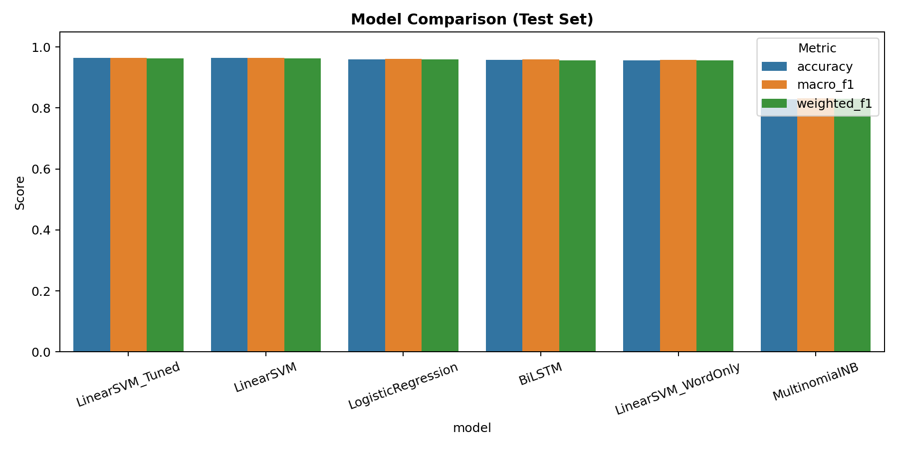

# Social Media Content Classification (Multiclass NLP)

A clean, reproducible NLP pipeline to classify social media posts into **6 emotion / mental-health categories**: `Positive`, `Neutral`, `Anger`, `Depression`, `Sadness`, and `Anxiety`.

---

## Dataset

* **Source:** [Mendeley Data (v2, DOI: 10.17632/rw57wvg6z2.2)](https://data.mendeley.com/datasets/rw57wvg6z2/2)
* **Size:** `42,518` raw rows → `42,507` after removing `11` case/whitespace duplicates (`0` nulls)
* **Classes & Split (70% Train / 15% Val / 15% Test):**
  * `Positive` (9,766 | 23.0%), `Neutral` (7,899 | 18.6%), `Anger` (7,121 | 16.8%), `Depression` (6,762 | 15.9%), `Sadness` (6,221 | 14.6%), `Anxiety` (4,738 | 11.1%)
  * **Imbalance:** `2.06×` (`Positive` vs. `Anxiety`) — handled using **balanced class weights** (computed only on train split) and evaluated primarily with **Macro-F1**.

---

## Project Structure

```text
socialmediaexp/
├── data/
│   ├── raw/                  # Put Mental_Health_6Class_Final_Cleaned.csv here
│   └── processed/            # train.csv, val.csv, test.csv
├── notebooks/
│   ├── 01_eda.ipynb          # Dataset audit & EDA plots
│   └── 02_experiments.ipynb  # Model comparison, curves & error analysis
├── src/
│   ├── utils.py              # Seed (42), device check, paths, logger
│   ├── data_loader.py        # Load data, drop duplicates/nulls, EDA plots
│   ├── preprocess.py         # Text cleaning & stratified 70/15/15 split
│   ├── features.py           # Word+Char TF-IDF & BiLSTM sequences
│   ├── train_classical.py    # NB, LogReg, LinearSVM, ablation & GridSearchCV
│   ├── train_deep.py         # GPU check -> PyTorch BiLSTM + early stopping
│   └── evaluate.py           # Test metrics, confusion matrices, error analysis, predict
├── models/                   # Saved vectorizers & trained models
├── results/                  # Plots, comparison CSV, classification reports
├── main.py                   # Runs the full pipeline (or --predict)
└── requirements.txt
```

---

## Pipeline Summary

1. **EDA (`src/data_loader.py`):** Audits nulls/duplicates, flags `2.06×` class imbalance and longer `Depression` posts (median 122 words vs. 10–23 words for other classes), and saves 4 plots.
2. **Preprocessing (`src/preprocess.py`):** Maps URLs → `<URL>`, `@mentions` → `<USER>`, `#FoodLover` → `food lover`, emojis → words (`emoji.demojize`), collapses elongated characters (`sooooo` → `soo`), expands contractions (`dont` / `don't` → `do not`), removes stopwords **keeping negations** (`not`, `no`, `never`), and lemmatizes.
3. **Features (`src/features.py`):** Combines Word `(1–2)` + Char `(2–5)` TF-IDF (`Word-Only` saved for ablation), plus padded integer sequences (`max_len=128`) for BiLSTM.
4. **Models (`src/train_classical.py`, `src/train_deep.py`):** Trains `MultinomialNB`, `LogisticRegression`, `LinearSVM` (tuned via `GridSearchCV`, `cv=3`, `f1_macro`), and a PyTorch **BiLSTM** (selected automatically when no GPU is present).
5. **Evaluation (`src/evaluate.py`):** Reports Accuracy, Macro/Weighted P/R/F1, raw & normalized confusion matrices, top misclassifications, and live `predict_post()`.

---

## How to Run

```bash
git clone https://github.com/mansi27102005/clnlp_exp9.git
cd clnlp_exp9
python -m venv .venv
.venv\Scripts\activate          # Linux/macOS: source .venv/bin/activate
pip install -r requirements.txt
```

Place `Mental_Health_6Class_Final_Cleaned.csv` in `data/raw/`, then run:

```bash
# Run full pipeline end-to-end
python main.py

# Predict on a single post
python main.py --predict "I feel so happy and grateful today!" --model LogisticRegression
```

---

## Results (Test Set, N = 6,376)

| Model | Accuracy | Macro Precision | Macro Recall | **Macro F1** | Weighted F1 |
| :--- | ---: | ---: | ---: | ---: | ---: |
| **LinearSVM_Tuned** (`C=1.0`) | **0.9636** | **0.9652** | **0.9650** | **0.9649** | **0.9634** |
| **LinearSVM** | 0.9636 | 0.9652 | 0.9650 | 0.9649 | 0.9634 |
| **LogisticRegression** | 0.9592 | 0.9609 | 0.9604 | 0.9605 | 0.9591 |
| **BiLSTM** (PyTorch) | 0.9569 | 0.9604 | 0.9576 | 0.9589 | 0.9567 |
| **LinearSVM_WordOnly** (Ablation) | 0.9555 | 0.9582 | 0.9569 | 0.9575 | 0.9553 |
| **MultinomialNB** | 0.8289 | 0.8742 | 0.8236 | 0.8315 | 0.8303 |




---

## Key Takeaways

* **Best Model:** `LinearSVM_Tuned` won with **0.9649 Macro-F1** (`96.36%` accuracy), followed by `LogisticRegression` (`0.9605`) and `BiLSTM` (`0.9589`).
* **Word+Char TF-IDF Ablation:** Adding character n-grams `(2–5)` improved `LinearSVM` Macro-F1 from `0.9575` to `0.9649` (**+0.74%**), helping with typos and slang.
* **Limitations:** Most errors (`3.64%`) occur between overlapping states like `Depression` vs. `Sadness` or very short ambiguous posts. Also, `Depression` posts are much longer on average, and the raw Mendeley CSV already removed emojis/hashtags/mentions (handled via `emoji.demojize()` for live inference).

---

## Team Members & License

* Mansi Naidu
* Vansh Bhatia

Licensed under the [MIT License](https://opensource.org/licenses/MIT).
