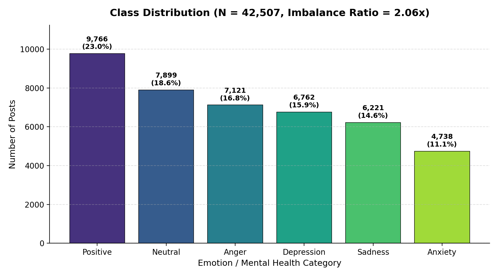
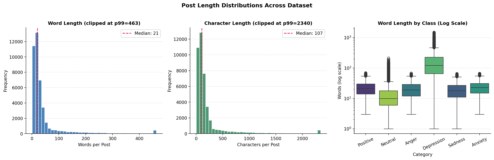
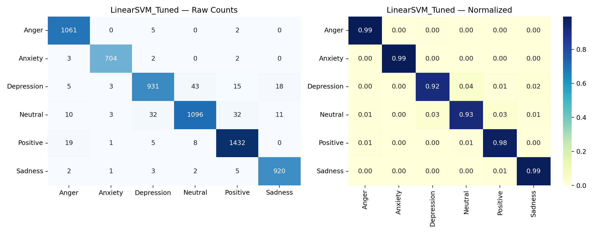

# Social Media Content Classification (Multiclass NLP)

A clean, reproducible multiclass NLP pipeline for classifying social media posts across **6 emotional and mental-health categories**: `Positive`, `Neutral`, `Anger`, `Depression`, `Sadness`, and `Anxiety`. Built as a university lab experiment with full EDA, social-media-specific preprocessing, classical TF-IDF models, a PyTorch **BiLSTM**, error analysis, and a CLI predictor.

---

## 1. Dataset Overview

* **Source:** [Mendeley Data (v2, DOI: 10.17632/rw57wvg6z2.2)](https://data.mendeley.com/datasets/rw57wvg6z2/2)
* **Size:** `42,518` raw rows → **`42,507`** after removing `11` case/whitespace-normalized duplicates (`0` nulls; `2` rows dropped post-cleaning → `42,505` split)
* **Split:** Stratified **70% Train (`29,753`) / 15% Validation (`6,376`) / 15% Test (`6,376`)** (`random_state=42`)
* **Class Imbalance:** `2.06×` (`Positive` vs. `Anxiety`) — handled with **balanced class weights** computed strictly on the training split (no oversampling before splitting to prevent leakage) and evaluated primarily using **Macro-F1**.

| Class | Count | Share | Train (70%) | Val (15%) | Test (15%) |
| :--- | ---: | ---: | ---: | ---: | ---: |
| `Positive` | 9,766 | 23.0% | 6,836 | 1,465 | 1,465 |
| `Neutral` | 7,899 | 18.6% | 5,529 | 1,184 | 1,184 |
| `Anger` | 7,121 | 16.8% | 4,985 | 1,068 | 1,068 |
| `Depression` | 6,762 | 15.9% | 4,733 | 1,014 | 1,015 |
| `Sadness` | 6,221 | 14.6% | 4,355 | 933 | 933 |
| `Anxiety` | 4,738 | 11.1% | 3,315 | 712 | 711 |




---

## 2. Project Structure

```text
socialmediaexp/
├── data/
│   ├── raw/                  # Place Mental_Health_6Class_Final_Cleaned.csv here
│   └── processed/            # Stratified train.csv, val.csv, test.csv
├── notebooks/
│   ├── 01_eda.ipynb          # Dataset audit, EDA plots & cleaning preview
│   └── 02_experiments.ipynb  # Model comparison, curves, errors & inference
├── src/
│   ├── utils.py              # Global seed (42), CPU/GPU check, paths, logger
│   ├── data_loader.py        # Load CSV, remove nulls/duplicates, generate EDA plots
│   ├── preprocess.py         # Social text cleaning & stratified 70/15/15 split
│   ├── features.py           # Word+Char TF-IDF, Word-Only TF-IDF & BiLSTM vocab
│   ├── train_classical.py    # MultinomialNB, LogReg, LinearSVM & GridSearchCV
│   ├── train_deep.py         # Hardware check -> PyTorch BiLSTM + early stopping
│   └── evaluate.py           # Test metrics, confusion matrices, error analysis & predict
├── models/                   # Saved vectorizers, label encoder & trained models
├── results/                  # Metrics CSV, classification reports & all plots
├── main.py                   # End-to-end pipeline runner & CLI (--predict)
└── requirements.txt          # Pinned Python dependencies
```

---

## 3. Pipeline Summary

1. **Data Collection & EDA (`src/data_loader.py`):** Loads the CSV, removes `11` case-normalized duplicates, audits text lengths (noting `Depression` posts are much longer, median 122 words vs. 10–23 words for other classes), and saves 4 plots.
2. **Preprocessing (`src/preprocess.py`):** Replaces URLs with `<URL>` and `@mentions` with `<USER>`, strips `#` while splitting CamelCase (`#FoodLover` → `food lover`), converts emojis to words (`emoji.demojize`), normalizes elongated words (`sooooo` → `soo`), expands both standard and apostrophe-less contractions (`dont` / `don't` → `do not`), removes stopwords **while keeping negations** (`not`, `no`, `never`), and lemmatizes with WordNet.
   | Raw Input | Preprocessed Output |
   | :--- | :--- |
   | `Cool httpwww.onlinemarktplatz.de...` | `cool <URL>` |
   | `i wasnt happy ... didnt change how i feel` | `not happy ... not change feel` |
   | `@user I'm sooooo stressed!! #MentalHealth 😢` | `<USER> soo stressed mental health cry face` |
3. **Feature Extraction (`src/features.py`):** Combines Word `(1–2)` TF-IDF (`50,000` features) + Char-wb `(2–5)` TF-IDF (`50,262` features) = `100,262` features, keeps a `Word-Only` vectorizer for ablation, and builds padded sequences (`vocab=13,912`, `max_len=128`) for BiLSTM.
4. **Model Training (`src/train_classical.py`, `src/train_deep.py`):** Trains `MultinomialNB`, `LogisticRegression`, and `LinearSVM` (tuned with `GridSearchCV`, `cv=3`, `scoring="f1_macro"`), plus a PyTorch **BiLSTM** (selected automatically since no GPU is available) with early stopping and class-weighted `CrossEntropyLoss`.
5. **Evaluation & Inference (`src/evaluate.py`):** Computes Accuracy, Macro/Weighted P/R/F1, raw & normalized confusion matrices, top misclassifications (`results/error_analysis.csv`), and live `predict_post()`.

---

## 4. How to Run

```bash
git clone https://github.com/mansi27102005/clnlp_exp9.git
cd clnlp_exp9
python -m venv .venv
.venv\Scripts\activate          # Linux/macOS: source .venv/bin/activate
pip install -r requirements.txt
```

Download `Mental_Health_6Class_Final_Cleaned.csv` into `data/raw/`, then run:

```bash
# Run the full pipeline end-to-end
python main.py

# Predict on a single raw post
python main.py --predict "I feel so happy and grateful today!" --model LogisticRegression

# Open exploratory and experiment notebooks
jupyter notebook notebooks/01_eda.ipynb
jupyter notebook notebooks/02_experiments.ipynb
```

---

## 5. Results (Held-Out Test Set, N = 6,376)

| Model | Accuracy | Macro Precision | Macro Recall | **Macro F1** | Weighted F1 |
| :--- | ---: | ---: | ---: | ---: | ---: |
| **LinearSVM_Tuned** (`C=1.0`, Word+Char) | **0.9636** | **0.9652** | **0.9650** | **0.9649** | **0.9634** |
| **LinearSVM** (Word+Char) | 0.9636 | 0.9652 | 0.9650 | 0.9649 | 0.9634 |
| **LogisticRegression** (Word+Char) | 0.9592 | 0.9609 | 0.9604 | 0.9605 | 0.9591 |
| **BiLSTM** (PyTorch, CPU) | 0.9569 | 0.9604 | 0.9576 | 0.9589 | 0.9567 |
| **LinearSVM_WordOnly** (Ablation) | 0.9555 | 0.9582 | 0.9569 | 0.9575 | 0.9553 |
| **MultinomialNB** (Word+Char) | 0.8289 | 0.8742 | 0.8236 | 0.8315 | 0.8303 |





---

## 6. Observations & Conclusion

* **Winning Model:** `LinearSVM_Tuned` achieved the top **0.9649 Macro-F1** (`96.36%` accuracy), edging out `LogisticRegression` (`0.9605`) and `BiLSTM` (`0.9589`). High-dimensional sparse TF-IDF n-grams excel at separating emotion keywords cleanly, while `MultinomialNB` (`0.8315`) struggles with the independence assumption and length variation.
* **Char N-grams Ablation:** Adding character `(2–5)` n-grams boosted `LinearSVM` Macro-F1 from `0.9575` to `0.9649` (**+0.74%**), capturing subword morphology, typos, and informal slang.
* **Error Analysis (`3.64%` error rate):** Most misclassifications (`232/6,376`) happen between overlapping mental-health states (`Depression` vs. `Sadness`) or very short ambiguous posts (e.g., mixed emotions or subtle neutral statements).
* **Limitations & Future Work:** The pre-cleaned Mendeley dataset already stripped hashtags, `@mentions`, and emojis (though our pipeline handles them via `emoji.demojize()` for live inference), and `Depression` posts are much longer on average. Future work includes fine-tuning `cardiffnlp/twitter-roberta-base` or `DistilBERT` on a GPU and applying probability calibration (`CalibratedClassifierCV`) for LinearSVM confidence scores.

---

## 7. Team Members & License

* Mansi Naidu
* Vansh Bhatia

Released under the [MIT License](https://opensource.org/licenses/MIT).
